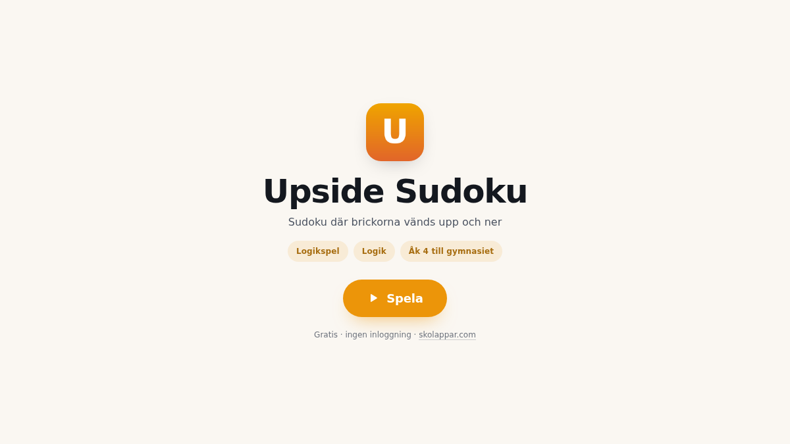

# Upside Sudoku

Sudoku för barn i låg- och mellanstadiet, i retrostil med 80-talskänsla. Barnet löser små
pussel – 4×4 med symboler och 6×6 med siffror – reser genom fem världar och samlar stjärnor,
XP och märken. Tränar koncentration och logiskt tänkande.

**Spela:** https://sudoku.skolappar.com · En del av [Skolappar](https://www.skolappar.com) – pedagogiska appar av föräldrar · öppen källkod (MIT)



Körs fristående.

## Vad du kan göra

- **Fem världar med tio pussel var**. De två första är 4×4 med symboler (🚲 🧇 📻 💡), de
  övriga 6×6 med siffror. Nya världar låses upp med stjärnor.
- **Stjärnor per pussel**: tre för snabbt och felfritt (under två minuter), annars två eller en.
- **Ledtrådar ("Elevens Power")**: tre per pussel, två i den dagliga utmaningen.
- **Daglig utmaning**: ett 6×6-pussel som är likadant för alla samma dag, med bonus-XP för
  svit av dagar.
- **Spelarprofil** med namn, avatar, nivå, XP och 13 märken att låsa upp.
- **Egen topplista** över dina dagliga utmaningar: snabbaste tider, senaste rundor och snitt.
- **Dela resultat**: appen ritar en bild av resultatet som du kan dela eller kopiera som text.
- **Spara och fortsätt** ett påbörjat pussel senare.
- Genomgång för nybörjare, timer, ljudeffekter och bakgrundsmusik som går att stänga av.

## Kom igång

```bash
npm install
npm run dev        # utvecklingsserver
npm run build      # produktionsbygge till dist/
npm run build:dev  # bygge i utvecklingsläge
npm run preview    # förhandsgranska bygget
npm run lint       # eslint
```

Docker-bygget använder Node 22.

## Docker

```bash
docker build -t upside-sudoku .
docker run --rm -p 8080:8080 upside-sudoku
```

Servern ligger bakom nginx med `deploy/nginx.conf`.

## Integritet

- Ingen spårning, inga kakor, ingen analys, inget konto, ingen AI, inga nätverksanrop.
  Topplistan är bara din egen och lämnar aldrig enheten.
- Typsnitten ligger i appen: Fredoka (`public/fonts/`) samt pixeltypsnitten Press Start 2P
  och VT323 via `@fontsource`. Ljud och musik skapas i webbläsaren med Web Audio.
- Allt sparas lokalt i `localStorage`:
  - `upside-down-sudoku-progress` – profil, stjärnor, XP, märken och dagliga utmaningar
  - `upside-down-sudoku-saved-game` – ett påbörjat pussel
  - `upside-down-sudoku-sounds` – ljudinställningar

  Rensa webbläsardata så är det borta.
- Delning sker bara när du själv trycker på knappen, via enhetens egen delningsmeny eller
  urklipp.

## Struktur

```
src/
  pages/Index.tsx                  växlar mellan meny, karta, pussel och statistik
  hooks/useGameState.ts            spelstatus, timer, ledtrådar, stjärnor, XP, sparat spel
  hooks/useSounds.ts               ljudinställningar
  lib/sudoku.ts                    generator för 4×4 och 6×6, ledtrådar, svårighetsgrad
  lib/gameData.ts                  världar, märken, avatarer, XP-regler
  lib/sounds.ts                    ljudeffekter och musik (Web Audio)
  components/game/MainMenu.tsx     startmeny
  components/game/WorldMap.tsx     världskartan
  components/game/GameBoard.tsx    spelplanen
  components/game/Tutorial.tsx     genomgång för nybörjare
  components/game/Leaderboard.tsx  egen topplista
  components/game/ShareResults.tsx resultatbild och delning
deploy/nginx.conf                  nginx-konfiguration för Docker
```

## Licens

MIT – se [LICENSE](LICENSE).
